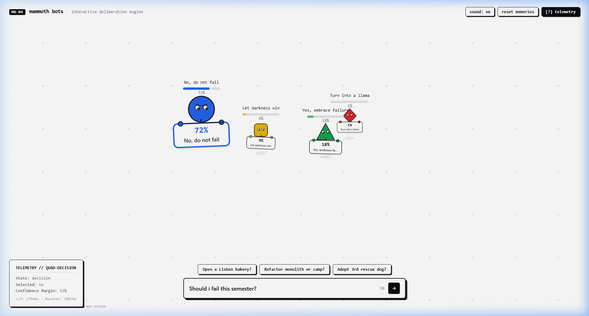

# 🦣 Mammoth Bots

> **Disclaimer:** I built this purely **for fun**! I wanted to see what happens when you pit specialized LLMs and decision models against each other inside a live, interactive browser canvas to resolve genuine human dilemmas.



---

## ⚡ What is this?

Mammoth Bots is an interactive deliberation playground featuring **four autonomous geometric robots** living on an architectural drafting board. When you present them with a dilemma—like *"Should I quit my job and open a bakery in Lisbon?"*—they huddle up, murmur in a scrum, and physically debate the verdict using a two-tier AI pipeline.

Each robot carries a dynamic placard displaying its stance and calibrated probability, tilting with physics as they wander, sulk, celebrate with confetti, or bump into each other when decisions are too close to call.

---

## 🤖 The Models Behind the Robots

I wanted to experiment with how modern models perform in real-time interactive web applications:

| Stage | Model | Provider | Role |
|---|---|---|---|
| **Option Synthesis** | `llama-3.3-70b-versatile` | **Groq** | Formulates 4 distinct opposing perspectives: **Forbidding** (Blue Circle), **Encouraging** (Green Triangle), **Absurd** (Red Diamond), and **Ominous** (Yellow Squircle). Written like a lawyer explaining a joke. |
| **Probability & Consensus** | `baseten/mammoth-1:free` | **OpenRouter / Baseten** | Specialized decision-scoring classifier that evaluates the normalized options against the user prompt to output a real probability distribution summing to 1.0. |

---

## ✨ Key Features & Mechanics

- **Autonomous Physics & Flocking**: Steering dynamics, wander forces, viewport edge avoidance, and input bar repulsion.
- **Organic Motion (De-AI'd)**: Asymmetric breathing periods, desynchronized eye blinks, and distinct character-driven dialogue lines instead of robotic animations.
- **Physical Handheld Boards**: Unnamed robots physically hold signs that swing and wobble with Verlet angular spring inertia.
- **Interactive Tactility**:
  - Drag and toss any bot across the canvas with realistic floor shadow diffusion and inertia.
  - Poke robots to trigger playful hop reactions.
  - Click anywhere to send shockwave ripples through nearby agents.
- **Contested Decisions (Coin Flips)**: When the top two options are within 5% of each other (`margin < 0.05`), the winner's crown is suppressed, and the top two bots physically bump into each other twice before staring straight into the camera.
- **Persistent Moods & Streaks**: Win/loss streaks persist locally with natural half-life decay on reload. Consecutive wins make bots boastful; long losing streaks cause them to droop and sulk away from past winners.
- **Synthesized Web Audio**: Zero-asset procedural Web Audio synthesizer producing gentle frequency sweeps for pokes, scrum murmurs, tosses, and chord chimes.
- **Diagnostic Telemetry**: Press `H` or `?` (or toggle `[?] telemetry`) to inspect real-time probabilities, LLM latency, and classification margins.

---

## 🛡️ Built-In Safeguards

- **Zero-Secret Client Exposure**: All API keys reside exclusively in the backend worker middleware. Bundles contain zero exposed tokens.
- **Sliding-Window Rate Limiting**: Built-in 10 requests/hour per IP token bucket with in-memory fallback, `Retry-After` headers, and client-side debounce guards.
- **Graceful Timeouts**: 14-second request abort safeguards ensure the robots never get locked in a thinking state if an upstream model times out.

---

## 🚀 Running Locally

### Prerequisites
- Node.js (v18+)
- A free [Groq API key](https://console.groq.com/) and [OpenRouter API key](https://openrouter.ai/) (optional, includes offline mock fallbacks).

### Setup

1. **Clone the repository:**
   ```bash
   git clone https://github.com/JanardhanS56/mammoth-bots.git
   cd mammoth-bots
   ```

2. **Install dependencies:**
   ```bash
   npm install
   ```

3. **Configure Environment Keys:**
   Create a `.env` file in the root directory:
   ```env
   groq_api_key=your_groq_api_key_here
   groq_model_name=llama-3.3-70b-versatile
   open_router_api_key=your_openrouter_api_key_here
   model_name=baseten/mammoth-1:free
   ```
   *(If keys are omitted, the engine automatically runs using fail-safe mock fallback generators).*

4. **Start the local development server:**
   ```bash
   npm run dev
   ```
   Open `http://localhost:5173/` in your browser.

5. **Run test suites:**
   ```bash
   npm test
   ```

---

## 🛠️ Architecture

- **Frontend**: Vanilla TypeScript + HTML5 Canvas + Vite (No heavyweight UI frameworks, sub-30KB static footprint).
- **Backend**: Cloudflare Worker runtime / Vite Dev Server Bridge.
- **Testing**: Vitest across all workspaces.

---

## 📜 License

MIT — Feel free to tinker, fork, and build your own robot deliberations!